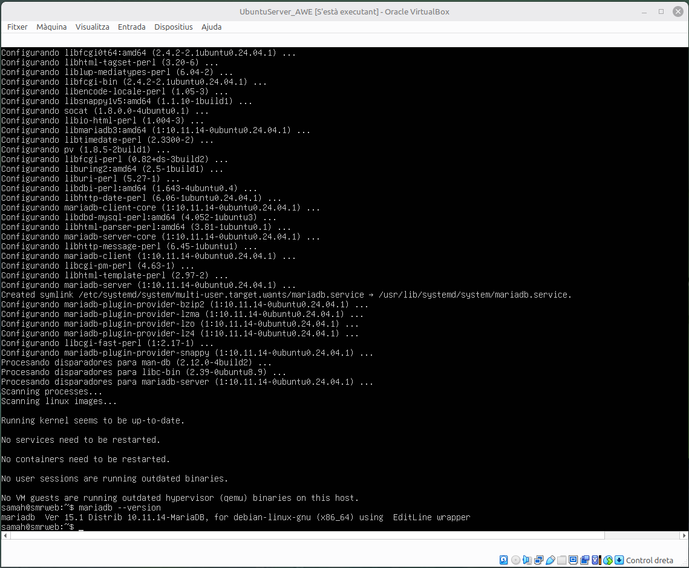

# Práctica: MariaDB y PHP en Ubuntu 24.04 (LAMP)

Sami ElKhalil Darwish Khouyi 2ºSMX

## 1. Preparación
```bash
sudo apt update
systemctl is-active apache2
```
Actualizo la lista de paquetes y compruebo que Apache sigue funcionando: responde `active`.

## 2. Instalación de MariaDB
```bash
sudo apt install mariadb-server -y
mariadb --version
```


Instalo el gestor de la base de datos. La versión instalada es MariaDB 10.11.

**Pregunta:** `mariadb-server` es el programa que guarda y gestiona los datos. `mariadb-client` es la herramienta para conectarse a él. He instalado `mariadb-server`, que incluye también el cliente.

## 3. Comprobación del funcionamiento
```bash
sudo systemctl status mariadb
systemctl is-enabled mariadb
sudo mariadb
```


El servicio aparece como `active (running)` y `enabled`. Con `sudo mariadb` entro en la consola de MariaDB y salgo con `exit`.

**Pregunta:** `active (running)` significa que el servicio funciona ahora mismo. `enabled` significa que arranca solo al encender el equipo. Si MariaDB estuviera active pero no enabled y se reiniciara el servidor, no arrancaría y WordPress daría error de conexión con la base de datos.
