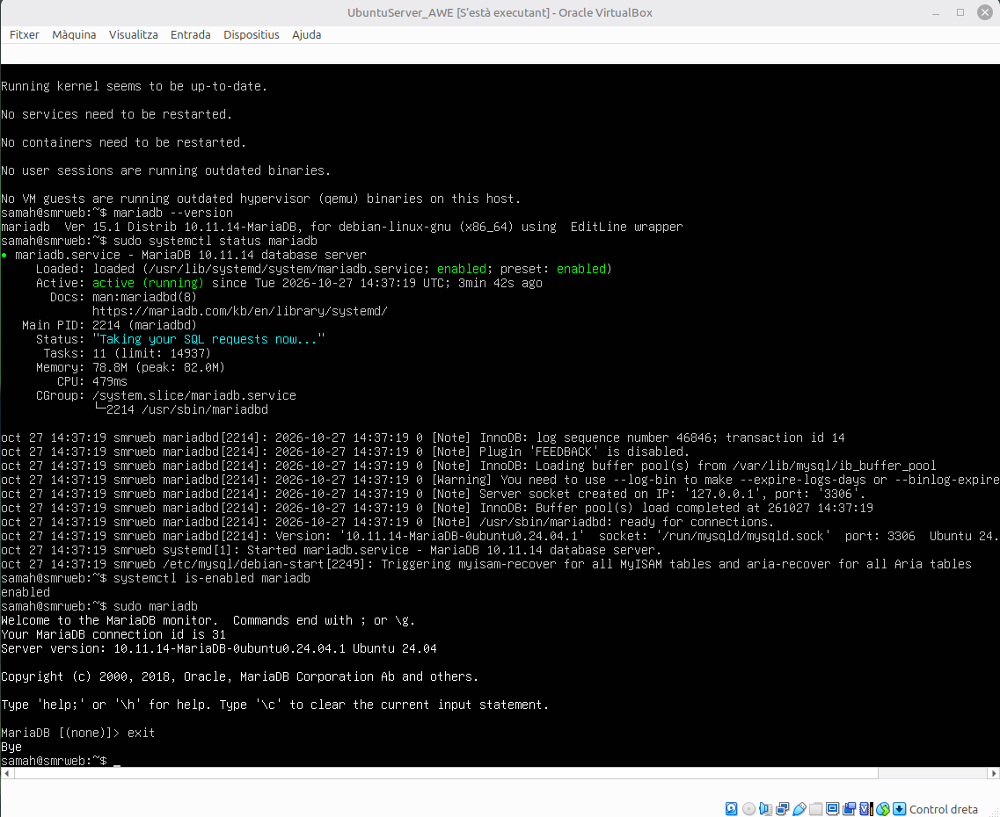
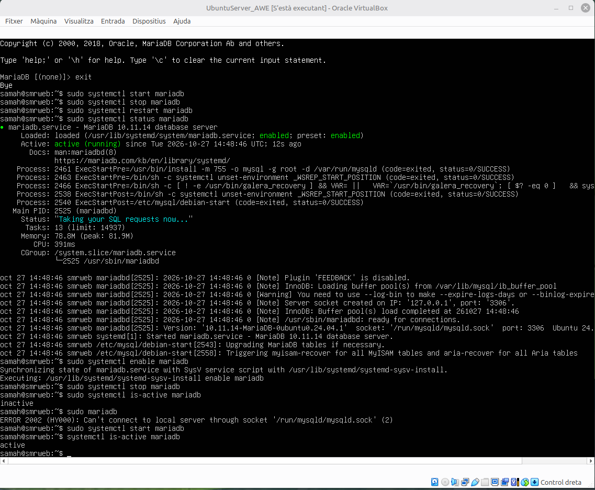
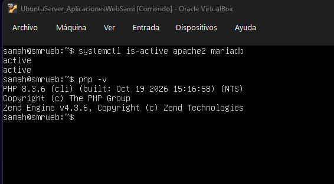
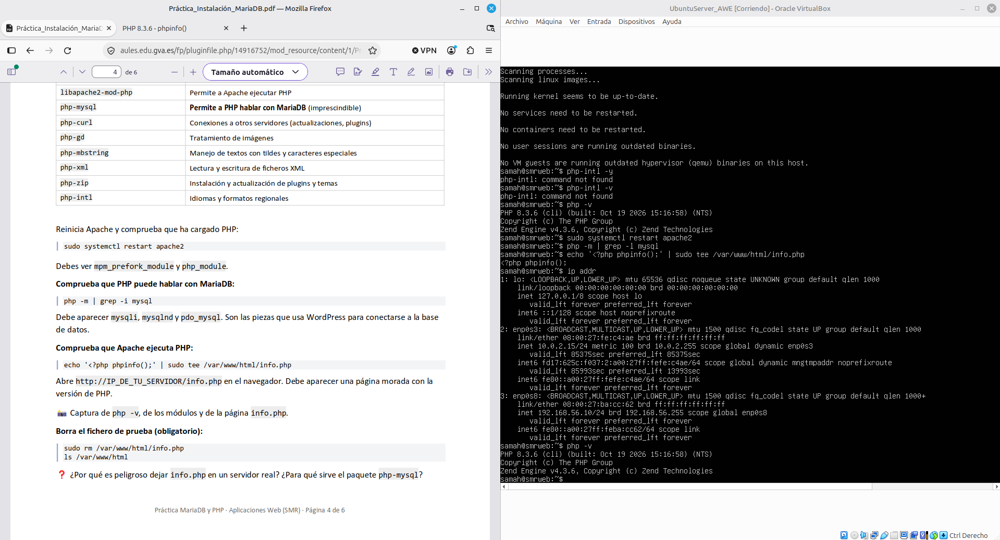
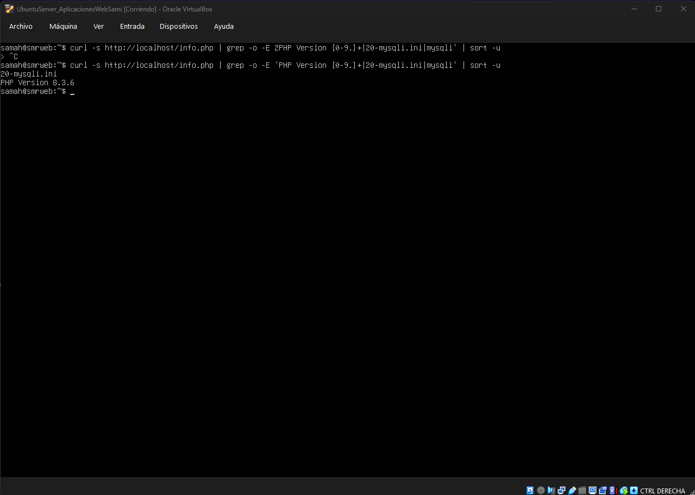
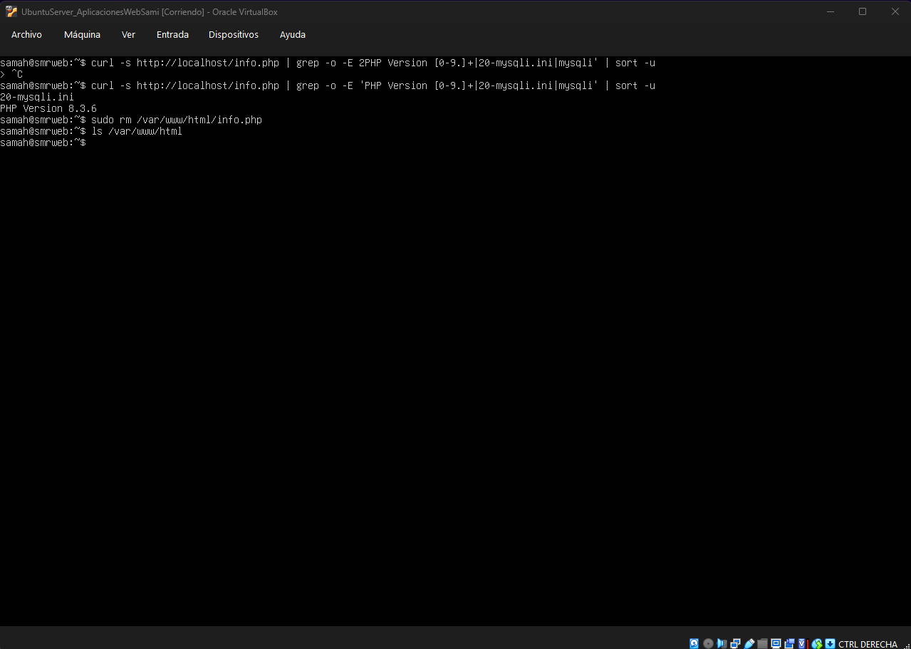

# Práctica: MariaDB y PHP en Ubuntu 24.04 (LAMP)

Sami ElKhalil Darwish Khouyi 2ºSMX

## 1. Preparación
```bash
sudo apt update
systemctl is-active apache2
```
Actualizo la lista de paquetes y compruebo que Apache sigue funcionando: responde `active`.

## 2. Instalación de MariaDB
```bash
sudo apt install mariadb-server -y
mariadb --version
```


Instalo el gestor de la base de datos. La versión instalada es MariaDB 10.11.

**Pregunta:** `mariadb-server` es el programa que guarda y gestiona los datos. `mariadb-client` es la herramienta para conectarse a él. He instalado `mariadb-server`, que incluye también el cliente.

## 3. Comprobación del funcionamiento
```bash
sudo systemctl status mariadb
systemctl is-enabled mariadb
sudo mariadb
```


El servicio aparece como `active (running)` y `enabled`. Con `sudo mariadb` entro en la consola de MariaDB y salgo con `exit`.

**Pregunta:** `active (running)` significa que el servicio funciona ahora mismo. `enabled` significa que arranca solo al encender el equipo. Si MariaDB estuviera active pero no enabled y se reiniciara el servidor, no arrancaría y WordPress daría error de conexión con la base de datos.

## 4. Comandos principales
| Comando | Qué hace |
|---|---|
| `sudo systemctl start mariadb` | Arranca el servicio |
| `sudo systemctl stop mariadb` | Detiene el servicio |
| `sudo systemctl restart mariadb` | Reinicia el servicio |
| `sudo systemctl status mariadb` | Muestra su estado |
| `sudo systemctl enable mariadb` | Lo arranca automáticamente al encender el equipo |

## 5. MariaDB parado
```bash
sudo systemctl stop mariadb
systemctl is-active mariadb
sudo mariadb
sudo systemctl start mariadb
systemctl is-active mariadb
```
Con el servicio parado, el estado es `inactive` y al entrar sale el error 2002 (no puede conectar con el socket). Al arrancarlo otra vez vuelve a `active`.

**Pregunta:** para saber si MariaDB está parado usaría `systemctl is-active mariadb` y `sudo systemctl status mariadb`.

## 6. Instalación de PHP
```bash
sudo apt install php libapache2-mod-php php-mysql php-curl php-gd php-mbstring php-xml php-zip php-intl -y
php -v
```


Instalo PHP 8.3 y los módulos que necesita WordPress.

```bash
sudo systemctl restart apache2
apache2ctl -M | grep -E 'mpm|php'
```


Apache ha cargado `mpm_prefork_module` y `php_module`.

```bash
echo '<?php phpinfo();' | sudo tee /var/www/html/info.php
curl -s http://localhost/info.php | grep -o -E 'PHP Version [0-9.]+|20-mysqli.ini|mysqli' | sort -u
```


El navegador no llegaba a la IP de la máquina virtual, así que comprobé `info.php` con `curl` desde la propia VM. Sale PHP 8.3.6 y el módulo `mysqli` cargado en Apache.

```bash
sudo rm /var/www/html/info.php
ls /var/www/html
```


Borro el fichero de prueba y compruebo que ya no está.

**Preguntas:**
- `info.php` es peligroso porque muestra la versión de PHP, los módulos, las rutas y la configuración del servidor, y un atacante puede usarlo para buscar vulnerabilidades.
- `php-mysql` permite que PHP hable con MariaDB. Sin él, WordPress no funciona.

## 7. Comprobación final
```bash
systemctl is-active apache2 mariadb
php -v
```


| Pieza del LAMP | Programa | Estado |
|---|---|---|
| Linux | Ubuntu 24.04 | Instalado |
| Apache | Apache2 | Funcionando |
| MariaDB | MariaDB 10.11 | Funcionando |
| PHP | PHP 8.3 | Funcionando y preparado para MariaDB |

## Conclusiones y problemas encontrados
1. Al copiar el comando de instalación de PHP se partió en dos líneas y `php-intl` no se instaló. Lo detecté con `php -m | grep -i intl` y lo resolví instalándolo aparte.
2. Escribí `grep -l` en lugar de `grep -i` y no salía nada. Lo corregí.
3. `php -m | grep -i mysql` no mostraba nada en la consola, aunque `php8.3-mysql` estaba instalado. Lo comprobé en el PHP de Apache, el que usará WordPress, con `info.php`, donde `mysqli` aparece cargado.
4. El navegador daba `ERR_CONNECTION_TIMED_OUT` al abrir la IP de la VM, mientras que `curl` en local daba 200. Por eso comprobé PHP con `curl`.
