# Práctica: Instalación de WordPress sobre el LAMP

**Nombre:** [tu nombre] · **Curso:** [tu curso] · **Fecha:** [fecha]

## 1. Comprobar el punto de partida
```bash
systemctl is-active apache2 mariadb
php -v
ls /etc/apache2/sites-enabled/
grep Listen /etc/apache2/ports.conf
```
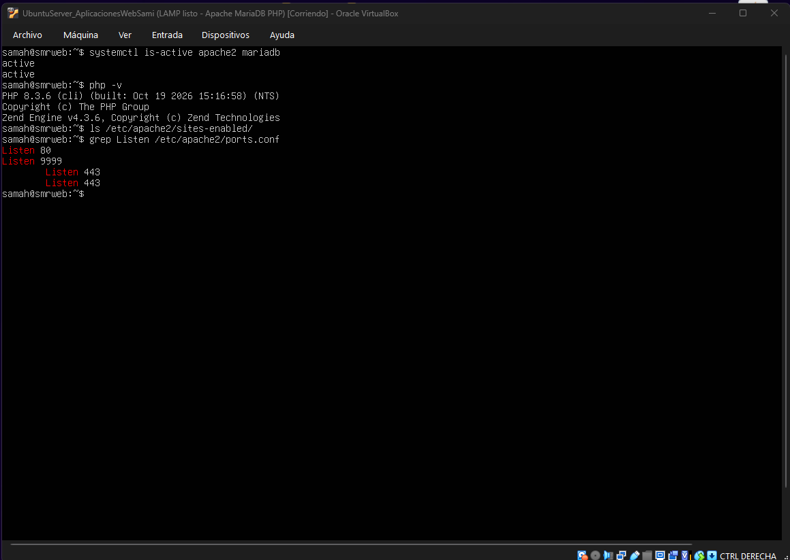

Apache y MariaDB responden `active` y PHP es la 8.3.6. Apache escucha en los puertos 80 y 9999 (el 443 es del SSL). La carpeta `sites-enabled` estaba vacía.

**Pregunta:** no tenía ningún sitio habilitado y Apache escuchaba en el 80 y el 9999. Uso el puerto 8080 porque el 80 ya está ocupado y cada sitio necesita un puerto o un nombre distinto.

## 2. Base de datos y usuario
```sql
CREATE DATABASE wordpress CHARACTER SET utf8mb4 COLLATE utf8mb4_unicode_ci;
CREATE USER 'wp_user'@'localhost' IDENTIFIED BY '********';
GRANT ALL PRIVILEGES ON wordpress.* TO 'wp_user'@'localhost';
FLUSH PRIVILEGES;
```
```bash
mariadb -u wp_user -p wordpress
SHOW TABLES;
```
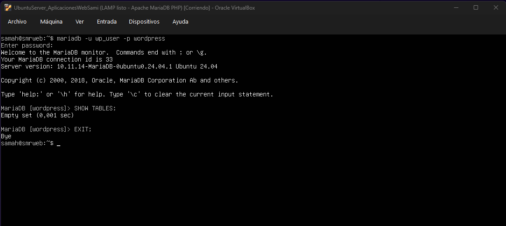

Creo la base de datos y un usuario que solo tiene permisos sobre ella. Al entrar con él sale `Empty set`, porque todavía no hay tablas.

**Preguntas:**
- Creo `wp_user` en lugar de usar `root` para que WordPress solo pueda tocar su propia base de datos y no todo MariaDB.
- `wordpress.*` significa todas las tablas de la base de datos `wordpress`.

## 3. Descargar WordPress y colocarlo
```bash
cd /tmp
wget https://wordpress.org/latest.tar.gz
tar -xzf latest.tar.gz
sudo mkdir -p /var/www/wordpress
sudo cp -a /tmp/wordpress/. /var/www/wordpress/
ls /var/www/wordpress
```
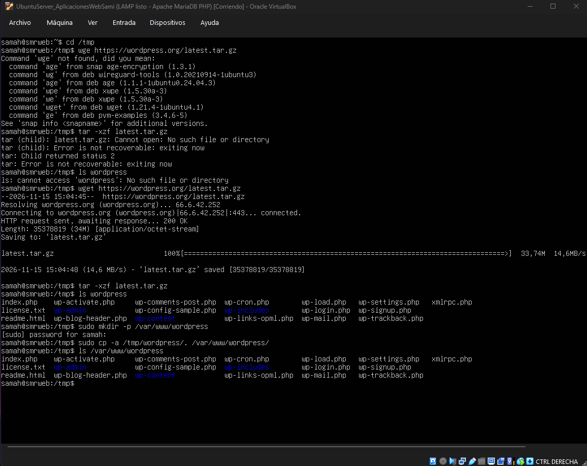

Descargo WordPress, lo descomprimo y copio su contenido a su carpeta definitiva.

**Preguntas:**
- La carpeta `wp-content` guarda los temas, los plugins y las imágenes subidas.
- WordPress va en su propia carpeta para no mezclar ficheros con otros sitios y poder copiarlo o borrarlo sin afectar a los demás.

## 4. Propietario y permisos
```bash
sudo chown -R www-data:www-data /var/www/wordpress
sudo find /var/www/wordpress -type d -exec chmod 755 {} \;
sudo find /var/www/wordpress -type f -exec chmod 644 {} \;
ls -l /var/www/wordpress
```
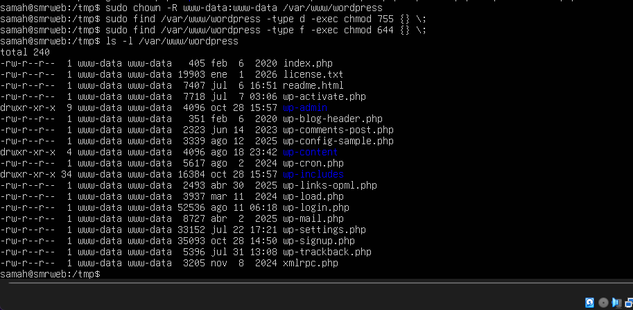

El propietario pasa a ser `www-data`, el usuario con el que corre Apache. Las carpetas quedan con 755 y los ficheros con 644.

**Preguntas:**
- Si el propietario fuera `root`, Apache (que corre como `www-data`) no podría escribir: no se crearía la configuración y no se podrían subir imágenes.
- No se usa nunca `777` porque da permiso de escritura a cualquiera, incluido quien consiga entrar al servidor.

## 5. Virtualhost de WordPress
Añado `Listen 8080` a `ports.conf` sin borrar nada y creo `wordpress.conf`.

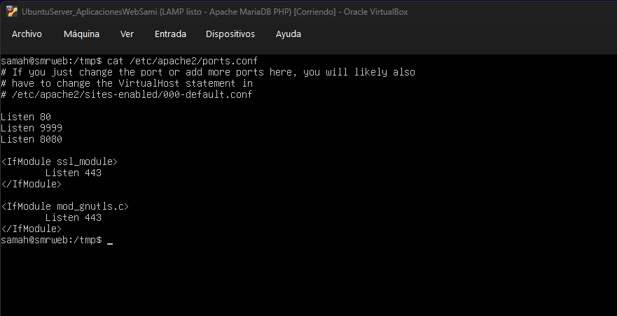
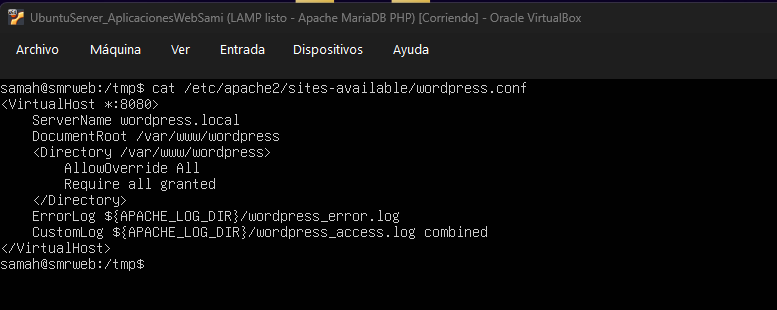

```bash
sudo a2enmod rewrite
sudo a2ensite wordpress.conf
sudo apachectl configtest
sudo systemctl restart apache2
ls /etc/apache2/sites-enabled/
```
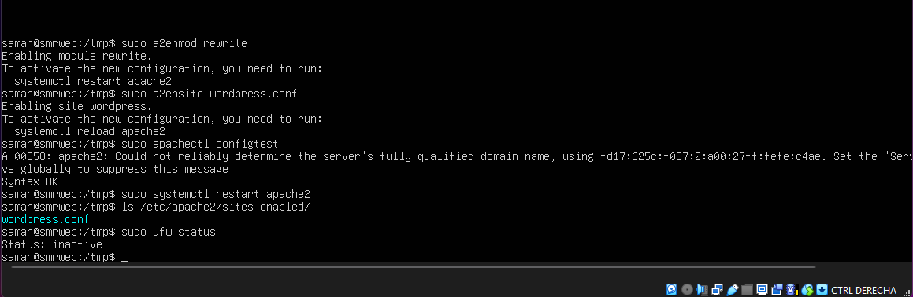

`configtest` responde `Syntax OK` y el sitio `wordpress.conf` aparece habilitado. El cortafuegos `ufw` está `inactive`, así que no hace falta abrir el puerto.

**Preguntas:**
- No ha hecho falta tocar ningún otro sitio porque cada sitio tiene su propio fichero `.conf`, su carpeta y su puerto.
- Este sitio se distingue de los demás por el puerto (8080) y por su carpeta (`/var/www/wordpress`).

## 6. Instalación desde el navegador
Entro desde el navegador de mi equipo en `http://192.168.56.10:8080`, siempre con la misma dirección.

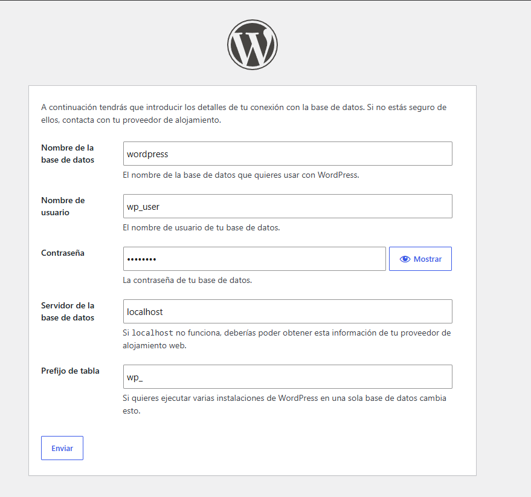
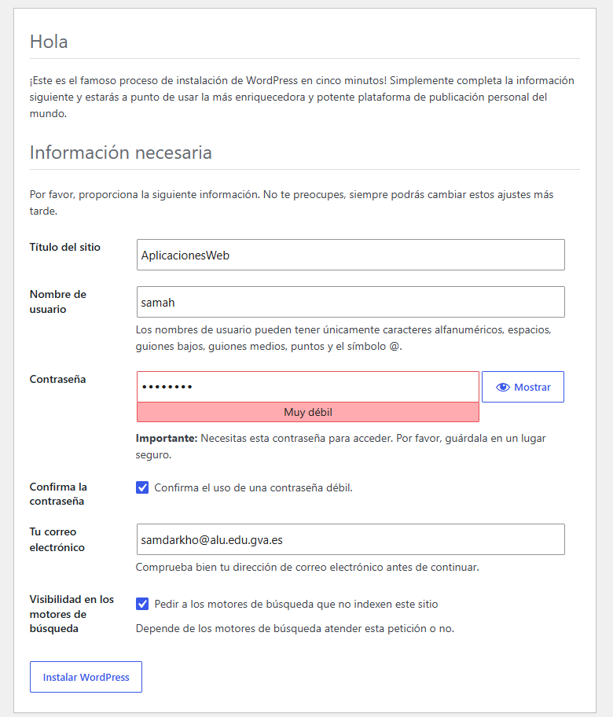
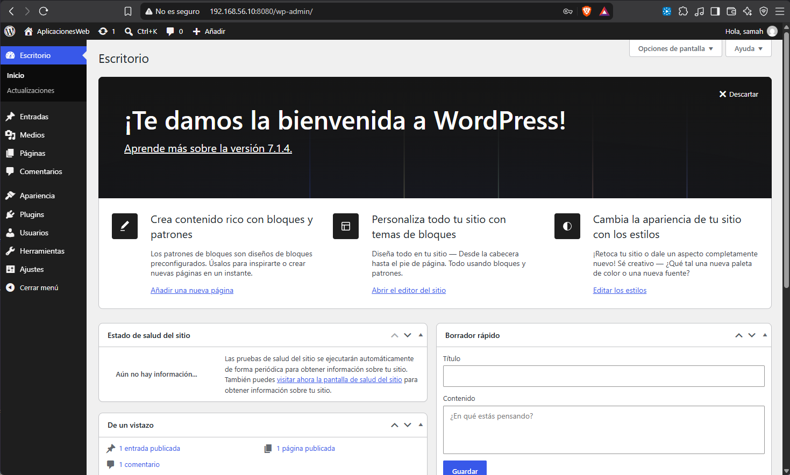

Uso la base `wordpress`, el usuario `wp_user`, el servidor `localhost` y el prefijo `wp_`. Después creo el administrador y llego al Escritorio.

**Pregunta:** `wp_user` vive en MariaDB y es el usuario con el que WordPress se conecta a la base de datos. El administrador vive en la tabla `wp_users` y es quien entra al panel de la web.

## 7. ¿Dónde ha guardado WordPress cada cosa?
```bash
sudo grep -E "DB_NAME|DB_USER|DB_HOST" /var/www/wordpress/wp-config.php
sudo chmod 640 /var/www/wordpress/wp-config.php
ls -l /var/www/wordpress/wp-config.php
```
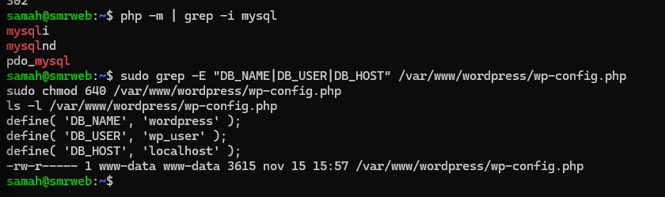

```sql
SHOW TABLES;
SELECT option_name, option_value FROM wp_options WHERE option_name IN ('siteurl','blogname');
SELECT user_login FROM wp_users;
```
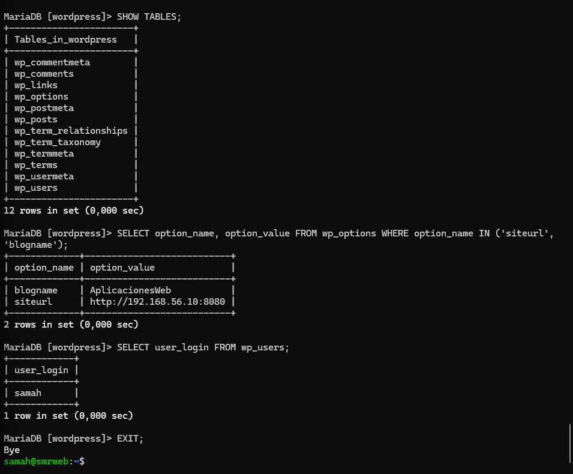

El asistente ha creado 12 tablas. El fichero `wp-config.php` guarda los datos de conexión y lo dejo con permisos 640 para que otros usuarios no lo lean.

**Preguntas:**
- `siteurl` vale `http://192.168.56.10:8080`, la dirección con la que instalé. Por eso WordPress siempre redirige a ella, aunque entre por otra.
- El administrador que creé está en la tabla `wp_users`.

## 8. Primera entrada e imagen
Publico la entrada "Hola desde mi WordPress" y subo una imagen desde Medios.

```sql
SELECT ID, post_title, post_type, post_status FROM wp_posts ORDER BY ID DESC LIMIT 5;
```
```bash
ls -R /var/www/wordpress/wp-content/uploads
```
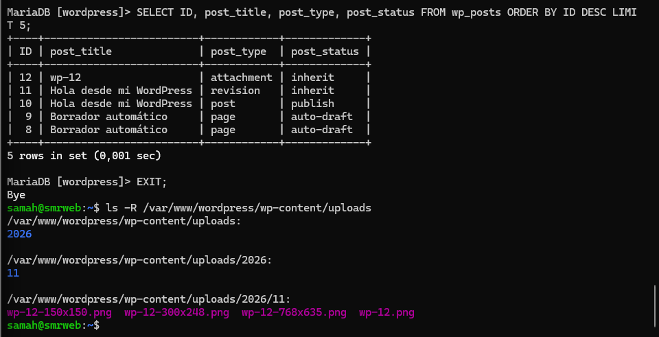

La entrada es una fila de tipo `post` en la base de datos. La imagen es un fichero en `wp-content/uploads/2026/11`, con tres tamaños extra que genera WordPress, y además una fila de tipo `attachment` que guarda sus datos.

**Preguntas:**
- En la base de datos se guardan las entradas, páginas, usuarios y ajustes. En ficheros se guardan el programa, los temas, los plugins y las imágenes subidas.
- Para una copia de seguridad completa copiaría la base de datos `wordpress` y la carpeta `/var/www/wordpress`.

## 9. Comprobación final
```bash
systemctl is-active apache2 mariadb
ls /etc/apache2/sites-enabled/
```


| Elemento | Dónde | Estado |
|---|---|---|
| Base de datos wordpress | MariaDB | Creada |
| Usuario wp_user | MariaDB | Creado, con permisos solo sobre wordpress |
| Ficheros de WordPress | /var/www/wordpress | Colocados, propietario www-data |
| Sitio de Apache | wordpress.conf, puerto 8080 | Activo |
| WordPress | http://192.168.56.10:8080 | Instalado y accesible |
| Sitios anteriores | Sus puertos de siempre | No estaban habilitados al empezar; no los he modificado |

**Pregunta:** al añadir WordPress no modifiqué ningún fichero de ningún otro sitio. Cada sitio tiene su propio `.conf`, carpeta y puerto, así que añadir uno nuevo no afecta a los demás. No he podido comprobar un sitio anterior funcionando (ver conclusiones).

## Conclusiones y problemas encontrados
1. **Sitios anteriores no habilitados.** Al empezar, `ls /etc/apache2/sites-enabled/` salía vacío (captura `wp-01`). En `sites-available` solo quedaba `000-default.conf`, aunque las carpetas `delta` y `smr` seguían en `/var/www`. No pude comprobar que los sitios anteriores funcionan, porque no estaban habilitados. WordPress no los afectó: lo añadí en su propio virtualhost sin tocar nada.
2. **Erratas al teclear.** Escribí `wge` en lugar de `wget`, y el `GRANT` con una coma en vez de un punto y una comilla sin cerrar. Lo corregí repitiendo los comandos bien.
3. **Contraseña del usuario.** Creé `wp_user` con una contraseña de ejemplo por error y la cambié con `ALTER USER`.
4. **WordPress daba error 500 ("Requirements Not Met").** PHP solo cargaba 21 módulos y no cargaba `mysqli`, aunque `php8.3-mysql` figuraba como instalado. Reinstalar los paquetes no lo arregló. Purgué los paquetes de PHP con `apt purge` y los instalé de nuevo: PHP pasó a cargar 54 módulos y WordPress respondió con `302`. No identifiqué la causa exacta.
